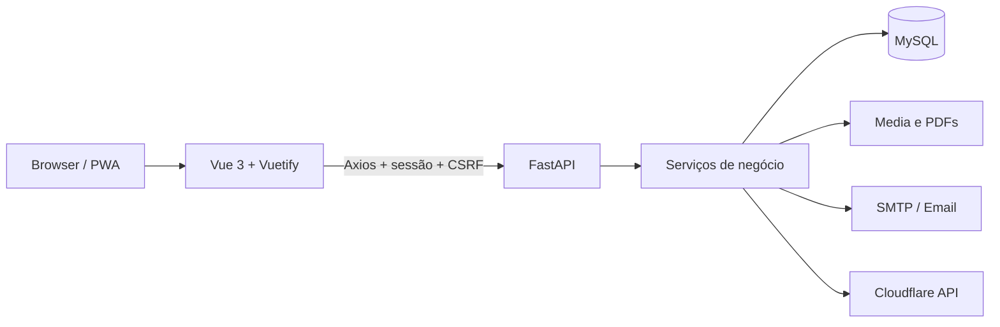

# Vitor Gouveia · Portal Comercial

<div align="center">


**Portal B2B para gestão de catálogos, encomendas, campanhas e clientes.**

[](https://www.python.org/)
[](https://fastapi.tiangolo.com/)
[](https://vuejs.org/)
[](https://vuetifyjs.com/)
[](https://www.mysql.com/)
[](#testes-e-validação)

[Produção](https://villas.mlabcorp.net/) · [Estado do serviço](https://villas.mlabcorp.net/ready)

</div>

---

## Sobre o projeto

O **Vitor Gouveia** é um portal comercial responsivo, desenvolvido sobretudo para utilização em tablet, mas totalmente funcional em computador e telemóvel. Centraliza o catálogo de produtos, encomendas, clientes, campanhas, promoções, documentos PDF e acompanhamento operacional numa única aplicação.

O sistema combina uma API em FastAPI com uma aplicação Vue 3 instalável como PWA. A autenticação é feita por **sessão/cookie com proteção CSRF**; o projeto não utiliza JWT.

## Funcionalidades

### Clientes

- Catálogos e permissões independentes por cliente.
- Carrinhos separados por catálogo e quantidades adaptadas aos múltiplos de cada artigo.
- Pesquisa, filtros, categorias e variantes de produto.
- Pré-visualização de produtos sem abandonar o catálogo.
- Histórico e repetição de encomendas.
- Geração de PDFs com ou sem preços.
- Campanhas direcionadas e promoções de oferta automáticas.
- Gestão dos próprios dados, moradas e preferência de tema.
- Experiência PWA otimizada para iPhone, iPad e tablets Android.

### Administração

- Gestão de clientes, contactos, moradas, entregas e transportadoras.
- Criação de encomendas em nome de clientes.
- Gestão de produtos, imagens, variantes, categorias e catálogos dinâmicos.
- Importação de produtos por Excel e por PDF, com pré-visualização, histórico e reversão.
- Importação e associação de imagens extraídas de catálogos PDF.
- Campanhas com imagem, texto opcional, produtos, descontos, datas e grupos de clientes.
- Promoções condicionais por valor, quantidade, marca ou referência, com ofertas e limites por cliente.
- Carrinhos pendentes, estatísticas mensais/anuais e exportação para Excel.
- PDFs configuráveis por encomenda ou cliente, incluindo observações opcionais.
- Convites pessoais por WhatsApp, de utilização única e validade configurável.
- Avisos de atualização com histórico, estados experimental/beta/estável e confirmação de leitura.
- Auditoria das ações administrativas e monitorização da saúde do sistema.

### Developer

- Acesso integral às áreas administrativas.
- Configuração global da aparência e das funcionalidades visuais do portal.
- Gestão segura do domínio, DNS e encaminhamento de email através da Cloudflare.
- Gestão de versões, patch notes, atualizações pendentes e notificações aos administradores.
- Diagnóstico do serviço e consulta do histórico operacional.

## Regras comerciais principais

| Regra | Valor |
| --- | --- |
| Nome público | **Vitor Gouveia** |
| Catálogo Villas | Encomenda mínima de **250 €** |
| Catálogo Utilidades | Encomenda mínima de **300 €** |
| Separação | Carrinhos, permissões e mínimos independentes por catálogo |
| Exceções | Administradores podem desbloquear mínimos e quantidades manuais |
| Nome público do segundo catálogo | **Utilidades** |

> O nome interno legado do catálogo Utilidades nunca deve ser apresentado aos clientes.

## Arquitetura



| Camada | Tecnologias |
| --- | --- |
| Backend | FastAPI, Pydantic 2, SQLAlchemy 2, Alembic, Uvicorn |
| Frontend | Vue 3, Vuetify 4, Vite 8, Pinia, Vue Router, Axios |
| Dados | MySQL 8 e PyMySQL |
| Documentos | ReportLab, pypdf, PDF.js, Pillow, OpenPyXL |
| Segurança | Argon2id, sessão HTTP-only, CSRF e controlo de permissões por função |
| Operação | systemd, scripts de atualização, monitorização e backups |
| Qualidade | pytest, Vitest e Vue Test Utils |

## Perfis e permissões

| Perfil | Acesso |
| --- | --- |
| Cliente | Catálogos autorizados, carrinhos, encomendas, campanhas e conta |
| Administrador | Operação comercial, clientes, produtos, campanhas, estatísticas e configurações permitidas |
| Developer | Acesso total, incluindo aparência, Cloudflare, atualizações e diagnóstico |

As permissões são validadas no backend. Ocultar um botão no frontend nunca substitui a autorização do servidor.

## Estrutura do repositório

```text
VillasV2/
├── app/                    # API, modelos, serviços, rotas e recursos do backend
│   ├── routes/             # Endpoints web e API
│   ├── static/             # Marca, ícones e recursos estáticos
│   └── templates/          # Templates de compatibilidade do backend
├── frontend/
│   ├── public/             # Manifesto e ícones da PWA
│   ├── scripts/            # Geração de recursos do frontend
│   ├── src/                # Aplicação Vue
│   │   ├── components/     # Componentes reutilizáveis
│   │   ├── composables/    # Comportamentos partilhados
│   │   ├── layouts/        # Estrutura e navegação da aplicação
│   │   ├── stores/         # Estado Pinia
│   │   └── views/          # Páginas públicas, cliente e administração
│   └── dist/               # Bundle compilado usado em produção
├── migrations/versions/    # Histórico do esquema da base de dados
├── scripts/                # Setup, importação, backup, restauro e publicação
├── systemd/                # Serviço, monitor e temporizadores
├── tests/                  # Testes do backend e integrações
├── updates/                # Metadados da versão e atualização pendente
├── .env.example            # Modelo de configuração sem credenciais
├── alembic.ini             # Configuração das migrações
└── pyproject.toml          # Dependências e configuração Python
```

## Preparar o ambiente local

### Requisitos

- Python 3.12 ou superior.
- Node.js compatível com Vite 8 e npm.
- MySQL 8.
- Git.

### 1. Backend

```powershell
python -m venv .venv
.\.venv\Scripts\Activate.ps1
python -m pip install --upgrade pip
pip install -e ".[dev]"
```

Em Linux/macOS, ativa o ambiente com `source .venv/bin/activate`.

### 2. Configuração

```powershell
Copy-Item .env.example .env
```

Preenche o `.env` local com as ligações à base de dados, segredos da aplicação e configuração de email. Nunca envies esse ficheiro para o Git.

As configurações abrangem:

- URL pública e ambiente da aplicação;
- bases de dados principal e de testes;
- sessão, cookies e CSRF;
- diretórios de media e logs;
- SMTP e remetente do portal.

### 3. Base de dados

```powershell
alembic upgrade head
```

As alterações ao esquema devem ser sempre implementadas através de uma nova migração Alembic.

### 4. Frontend

```powershell
npm ci --prefix frontend
npm run dev --prefix frontend
```

### 5. Iniciar a API

```powershell
uvicorn app.main:app --reload
```

## Testes e validação

Executa toda a validação antes de publicar:

```powershell
.\.venv\Scripts\python.exe -m pytest -q
npm test --prefix frontend
npm run build --prefix frontend
```

Estado da última validação completa:

- **104 testes backend aprovados**;
- **5 testes backend ignorados**;
- **6 testes frontend aprovados**;
- bundle de produção e service worker gerados com sucesso.

O build cria `frontend/dist`, incluindo os recursos versionados, manifesto e service worker da PWA.

## Publicação

O projeto inclui suporte para publicação controlada por systemd e para atualizações iniciadas a partir da área Developer.

Fluxo recomendado:

1. Executar testes do backend e frontend.
2. Compilar `frontend/dist`.
3. Aplicar as migrações Alembic necessárias.
4. Publicar apenas os ficheiros alterados e o bundle compilado.
5. Reiniciar o serviço da aplicação.
6. Confirmar `/ready`, a página principal e os registos recentes do serviço.

Endpoints de estado:

| Endpoint | Finalidade |
| --- | --- |
| `GET /health` | Confirma que a aplicação está a responder |
| `GET /ready` | Confirma que a aplicação e as dependências estão prontas |

## Atualizações e versões

- A versão publicada e os patch notes são definidos em `updates/current.json`.
- Atualizações pendentes são preparadas fora do controlo de versão.
- O portal permite classificar versões, criar avisos e acompanhar quem viu, ignorou ou confirmou a leitura.
- O atualizador do servidor valida e aplica o pacote, mantendo o processo separado da interface pública.

## Segurança

- Credenciais e segredos pertencem exclusivamente ao `.env` ou ao armazenamento seguro do servidor.
- Tokens da Cloudflare nunca são devolvidos ao navegador depois de guardados.
- Cookies de sessão devem usar `Secure`, `HttpOnly` e uma política `SameSite` adequada em produção.
- Operações que alteram dados exigem sessão válida e proteção CSRF.
- Passwords são protegidas com Argon2id.
- Logs, bases locais, media carregada, backups, dependências e pacotes temporários não são versionados.
- Nunca coloques passwords, tokens, chaves privadas, cookies ou dados reais de clientes em commits, testes ou documentação.

## Convenções de desenvolvimento

- Mantém as regras de negócio no backend e a interface focada na apresentação.
- Reutiliza componentes e composables antes de duplicar lógica Vue.
- Cria uma migração para cada mudança persistente no modelo de dados.
- Adiciona testes de regressão sempre que corrigires um erro.
- Usa commits pequenos e descritivos, separados por funcionalidade, correção, build ou manutenção.
- Preserva a compatibilidade entre computador, tablet, iPhone e PWA instalada.

Exemplos de commits:

```text
feat(campaigns): adicionar grupos de clientes
fix(cart): respeitar múltiplos do produto
test(import): cobrir referências partidas em PDF
build(frontend): atualizar bundle de produção
```

## Privacidade e utilização

Este é um projeto comercial privado. O código, os dados, os recursos de marca e a documentação não devem ser redistribuídos sem autorização.

---

<div align="center">

Desenvolvido para a operação comercial **Vitor Gouveia**.

</div>
