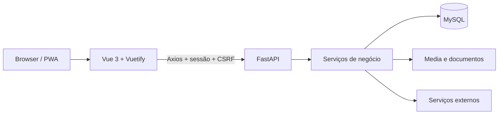

# MLabCorp · B2B Commerce Platform

<div align="center">


### Plataforma moderna para catálogos, encomendas e operações comerciais

[](https://www.python.org/)
[](https://fastapi.tiangolo.com/)
[](https://vuejs.org/)
[](https://vuetifyjs.com/)
[](https://www.mysql.com/)
[](#qualidade)

</div>

---

## Visão geral

Esta aplicação é uma plataforma B2B responsiva para centralizar catálogos, produtos, encomendas, campanhas e tarefas administrativas. Foi desenhada para funcionar de forma consistente em computador, tablet, telemóvel e como aplicação PWA instalada.

O backend disponibiliza uma API FastAPI com regras de negócio e autorização centralizadas. O frontend utiliza Vue 3 e Vuetify para oferecer uma experiência rápida, acessível e adaptável a diferentes dimensões de ecrã.

## Capacidades principais

### Catálogo e conteúdos

- Vários catálogos com acessos e configurações independentes.
- Produtos com categorias, variantes, múltiplos, imagens e disponibilidade.
- Pesquisa, filtros e navegação adaptada a interfaces táteis.
- Pré-visualização e edição em janelas internas, sem perder o contexto da página.
- Importação por folhas de cálculo e documentos PDF.
- Processamento e otimização de imagens de produto.

### Encomendas

- Carrinhos independentes por catálogo.
- Regras de quantidade, mínimos e permissões configuráveis.
- Criação, repetição e acompanhamento de encomendas.
- Fluxos administrativos para criação assistida.
- Documentos PDF configuráveis, com ou sem preços.
- Exportação de dados e estatísticas por período.

### Campanhas e promoções

- Campanhas com imagem, texto opcional, período de atividade e audiência.
- Associação direta entre campanhas e produtos.
- Segmentação através de grupos.
- Descontos e ofertas condicionais por valor, quantidade ou seleção de artigos.
- Limites de utilização e acompanhamento das ofertas atribuídas.

### Administração

- Gestão de utilizadores, acessos e estado das contas.
- Gestão de produtos, categorias e catálogos.
- Histórico de importações e reversão controlada.
- Auditoria de ações administrativas.
- Monitorização do estado da aplicação e das suas dependências.
- Gestão de versões, notas de atualização e confirmações de leitura.
- Preferências globais de interface e funcionalidades.

### Experiência multiplataforma

- Layout responsivo com prioridade para tablets.
- Navegação inferior em ecrãs compactos.
- Áreas seguras para dispositivos iOS.
- Tema claro/escuro e preferências por utilizador.
- Manifesto instalável e service worker.
- Comportamento offline controlado, sem colocar operações críticas em risco.

## Arquitetura



| Camada | Tecnologias |
| --- | --- |
| Backend | FastAPI, Pydantic 2, SQLAlchemy 2, Alembic e Uvicorn |
| Frontend | Vue 3, Vuetify 4, Vite 8, Pinia, Vue Router e Axios |
| Dados | MySQL 8 e PyMySQL |
| Documentos | ReportLab, pypdf, PDF.js, Pillow e OpenPyXL |
| Autenticação | Sessão HTTP-only, proteção CSRF e Argon2id |
| Operação | systemd, migrações, monitorização e backups |
| Qualidade | pytest, Vitest e Vue Test Utils |

## Segurança por conceção

- Autenticação por sessão/cookie; não utiliza JWT.
- Proteção CSRF nas operações que alteram dados.
- Autorização validada no backend para todas as áreas protegidas.
- Passwords protegidas com Argon2id.
- Cookies de produção configuráveis com `Secure`, `HttpOnly` e `SameSite`.
- Segredos e credenciais mantidos fora do controlo de versão.
- Logs, bases locais, uploads, backups e ficheiros temporários ignorados pelo Git.
- Integrações externas isoladas em serviços próprios e sem exposição de credenciais ao browser.

> Nunca devem ser incluídos no repositório dados pessoais, credenciais, tokens, cookies, ficheiros `.env`, chaves privadas ou informação real de operações comerciais.

## Perfis de acesso

| Perfil | Responsabilidade |
| --- | --- |
| Utilizador | Consulta de conteúdos autorizados e realização de operações comerciais |
| Administrador | Gestão operacional, conteúdos, utilizadores e acompanhamento |
| Developer | Configurações técnicas, diagnóstico, integrações e atualizações |

As permissões são aplicadas no servidor. As restrições visuais do frontend funcionam apenas como complemento da segurança.

## Estrutura do repositório

```text
.
├── app/                    # API, modelos, serviços e rotas do backend
│   ├── routes/             # Endpoints web e API
│   ├── static/             # Recursos estáticos da aplicação
│   └── templates/          # Templates de compatibilidade
├── docs/assets/            # Identidade visual da documentação
├── frontend/
│   ├── public/             # Manifesto e ícones da PWA
│   ├── scripts/            # Geração de recursos do frontend
│   ├── src/
│   │   ├── components/     # Componentes reutilizáveis
│   │   ├── composables/    # Comportamentos partilhados
│   │   ├── layouts/        # Estrutura e navegação
│   │   ├── stores/         # Estado Pinia
│   │   └── views/          # Páginas da aplicação
│   └── dist/               # Bundle compilado
├── migrations/versions/    # Histórico do esquema da base de dados
├── scripts/                # Setup, importação, backup e publicação
├── systemd/                # Serviço e monitorização
├── tests/                  # Testes do backend e integrações
├── updates/                # Metadados de versões
├── .env.example            # Modelo de configuração sem valores reais
├── alembic.ini             # Configuração Alembic
└── pyproject.toml          # Projeto e dependências Python
```

## Desenvolvimento local

### Requisitos

- Python 3.12 ou superior.
- Node.js compatível com Vite 8 e npm.
- MySQL 8.
- Git.

### Backend

```powershell
python -m venv .venv
.\.venv\Scripts\Activate.ps1
python -m pip install --upgrade pip
pip install -e ".[dev]"
```

Em Linux ou macOS, ativa o ambiente com `source .venv/bin/activate`.

### Configuração

Cria a configuração local a partir do modelo:

```powershell
Copy-Item .env.example .env
```

O ficheiro `.env` deve conter apenas valores do ambiente local e nunca deve ser enviado para o Git.

### Base de dados

```powershell
alembic upgrade head
```

Cada mudança persistente ao modelo de dados deve ser acompanhada por uma migração Alembic.

### Frontend

```powershell
npm ci --prefix frontend
npm run dev --prefix frontend
```

### API

```powershell
uvicorn app.main:app --reload
```

## Qualidade

Executa a validação completa antes de publicar:

```powershell
.\.venv\Scripts\python.exe -m pytest -q
npm test --prefix frontend
npm run build --prefix frontend
```

O build gera `frontend/dist`, incluindo recursos versionados, manifesto e service worker da PWA.

Endpoints de diagnóstico disponíveis nos ambientes configurados:

| Endpoint | Objetivo |
| --- | --- |
| `GET /health` | Confirma que o processo da aplicação responde |
| `GET /ready` | Confirma que a aplicação e as dependências estão prontas |

## Publicação

Fluxo recomendado:

1. Executar os testes do backend e frontend.
2. Compilar o bundle de produção.
3. Aplicar as migrações necessárias.
4. Publicar apenas código e artefactos previstos.
5. Reiniciar o serviço de forma controlada.
6. Confirmar os endpoints de diagnóstico e os registos recentes.

Os detalhes de infraestrutura, endereços, credenciais e procedimentos específicos de cada ambiente devem permanecer em documentação privada, fora deste README.

## Convenções de desenvolvimento

- Mantém as regras de negócio e autorizações no backend.
- Reutiliza componentes e composables antes de duplicar lógica Vue.
- Cria migrações pequenas e reversíveis.
- Adiciona testes de regressão para cada correção relevante.
- Preserva a experiência em computador, tablet, telemóvel e PWA.
- Separa commits por funcionalidade, correção, teste, documentação ou build.
- Não versiona dependências instaladas nem artefactos temporários.

```text
feat(catalog): adicionar filtro de disponibilidade
fix(cart): corrigir atualização de quantidades
test(import): cobrir documento com linhas partidas
docs(readme): atualizar documentação técnica
build(frontend): atualizar bundle de produção
```

## Utilização

Projeto privado e proprietário da **MLabCorp**. O código, os recursos e a documentação não devem ser redistribuídos sem autorização.

---

<div align="center">

**MLabCorp** · Software, automação e infraestrutura

</div>
